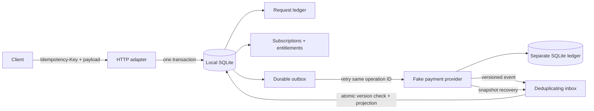

# Idempotency Prototype

**A small, runnable demonstration of crash-safe billing and convergent entitlements.** Python 3.11+ · standard library only · SQLite · MIT

A checkout retry must not create a second subscription or charge. A payment can succeed while the caller crashes before recording the result. Webhooks can arrive twice, arrive late, or disappear. This repository makes those failure boundaries executable.

## Run in 30 seconds

```sh
python3 demo.py
python3 -m unittest discover -s tests -v
```

The demo creates temporary databases, retries a duplicate checkout, crashes after the provider commits, restarts the service, and repairs a dropped cancellation event using a snapshot. Its assertions verify one provider charge and the final entitlement state.

## Architecture



The request transaction writes the subscription, immutable response, disabled entitlement, and outbox row together. A worker calls the provider **outside** the local transaction. The provider independently commits its idempotency record. The worker then atomically records the local charge and event, updates the entitlement, and marks the outbox complete. A crash in the middle leaves replayable work; it does not roll back the provider.

## HTTP walkthrough

Start the loopback server:

```sh
python3 server.py serve
```

In another terminal:

```sh
curl -i http://127.0.0.1:8080/subscriptions \
  -H 'Content-Type: application/json' \
  -H 'Idempotency-Key: checkout-42' \
  -d '{"customer":"alice","amount":1500}'
python3 server.py drain
curl 'http://127.0.0.1:8080/entitlements?customer=alice'
python3 server.py reconcile
```

Repeat the POST with the same key and payload to receive the same `202` response. Change the amount with the same key to receive `409`. Amounts are positive integer cents, at most 100,000,000; this demonstration uses one implicit currency. Responses preserve the original `pending` acceptance result even after processing. Query entitlement separately.

| Interface | Result |
| --- | --- |
| `POST /subscriptions`, `Idempotency-Key` header | `202` durable acceptance, `400` invalid input, `409` payload conflict |
| `GET /entitlements?customer=alice` | `200` customer access projection |
| `python3 server.py drain` | Process currently pending outbox rows; print number completed |
| `python3 server.py reconcile` | Apply current provider snapshots; print number advanced |

All commands accept `--db` and `--provider-db`; the server also accepts `--port`. Defaults are `billing.db`, `provider.db`, and port 8080. Retrying after a provider outage requires another `drain` invocation. `Billing.receive()` and `Provider.set_status()` expose the event simulation API; no unauthenticated webhook/admin HTTP endpoints are exposed.

## Guarantees and evidence

| Failure | Mechanism | Automated evidence |
| --- | --- | --- |
| Duplicate checkout after restart | Durable key, canonical payload, stored response | `test_replay_is_durable` |
| Concurrent duplicate requests/workers | SQLite write serialization + unique keys | `test_concurrent_retries` |
| Same key, different payload | Conflict before mutation | `test_payload_conflict` |
| Crash after external charge | Stable operation ID and provider ledger | `test_crash_after_provider_commit` |
| Provider unavailable | Pending outbox retained with attempts/error | `test_retry_preserves_pending_outbox` |
| Duplicate or stale webhook | Inbox event ID and increasing aggregate version | `test_out_of_order_events_and_duplicates` |
| Dropped cancellation | Authoritative snapshot through same reconciler | `test_dropped_event_repaired_by_snapshot` |
| Late and duplicate usage | Independent delta ledger, stable IDs | `test_usage_late_arrival_duplicates_and_conflicts` |
| Local charge after crash | Atomic receipt + outbox acknowledgement | `test_local_charge_recorded_atomically_after_recovery` |
| Invalid request/event | Boundary validation | `test_invalid_inputs`, `test_http_contract` |

## Usage events are deltas, not state snapshots

`Billing.record_usage(event)` accepts `{event_id, subscription_id, sequence, units}`. Positive integer units are appended to a durable ledger, deduplicated by event ID with payload conflict protection. `usage_total(subscription_id)` sums accepted deltas. Sequence 2 arriving before sequence 1 still counts both; a version high-water mark would silently lose usage. A duplicate adds zero units. Totals survive restart; malformed or unknown-subscription events are rejected.

Provider status governs access; usage is accounting only, with no quota enforcement or metered invoicing. Dropped **usage** events require upstream replay; provider snapshots repair subscription status only. Real usage operations need stable producer-issued IDs; distinct IDs for one operation cannot be detected here.

`Billing.charges(subscription_id)` returns the local charge ledger with stable provider operation ID and integer amount. This row commits with the outbox acknowledgement, so a crash before local commit leaves no partial local charge receipt.

## Deliberate production boundaries

This is an educational service, not a payment processor. The single-host SQLite design serializes writers; there are no distributed worker leases, queue polling, exponential backoff, observability backend, migrations, or dead-letter management. Workers can call the provider concurrently; correctness relies on provider-side durable idempotency. There is no claim of universal exactly-once delivery.

The fake provider retains keys forever and uses integer, per-subscription versions. A real integration needs a documented provider key-retention contract, trustworthy ordering/version semantics, authenticated and signed webhooks, snapshot pagination, rate-limit handling, and reconciliation scheduling. Snapshot recovery is eventual: dropped cancellations temporarily leave access enabled. Entitlements grant access if **any** subscription for a customer is active; a different checkout key intentionally creates a separate subscription.

The HTTP server has no TLS, authentication, tenant isolation, or production resource controls. It binds only to loopback and should not be exposed. Event IDs are conflict-protected; equal or lower aggregate versions cannot overwrite state. Unknown subscriptions are rejected for later redelivery, rather than creating accounts implicitly. An attacker-controlled stream of event IDs could exhaust storage without production retention controls.

See [design notes](docs/design.md) and [implementation plan](docs/implementation-plan.md).
